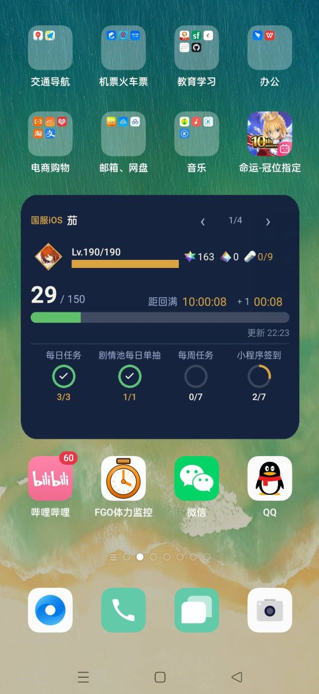
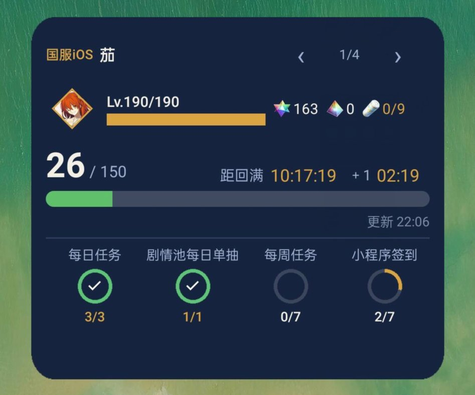
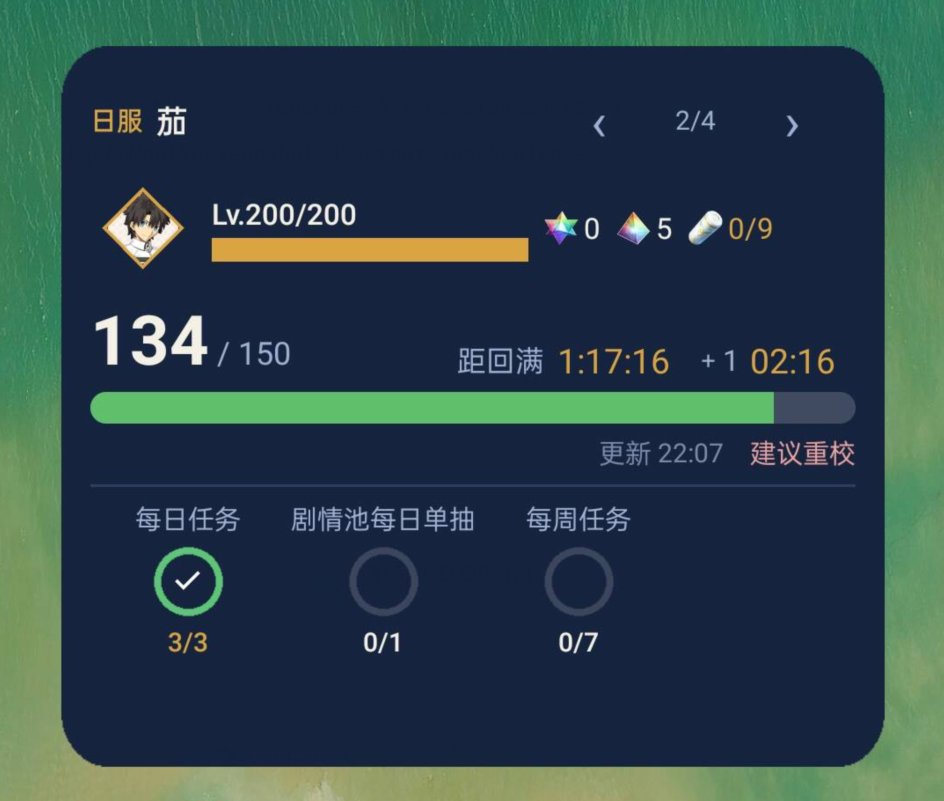
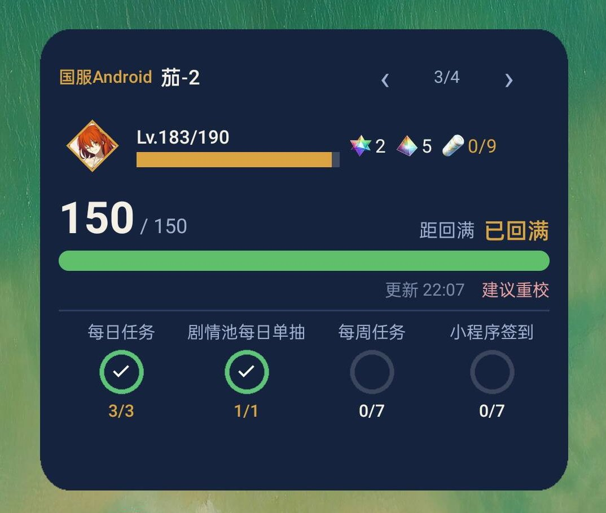
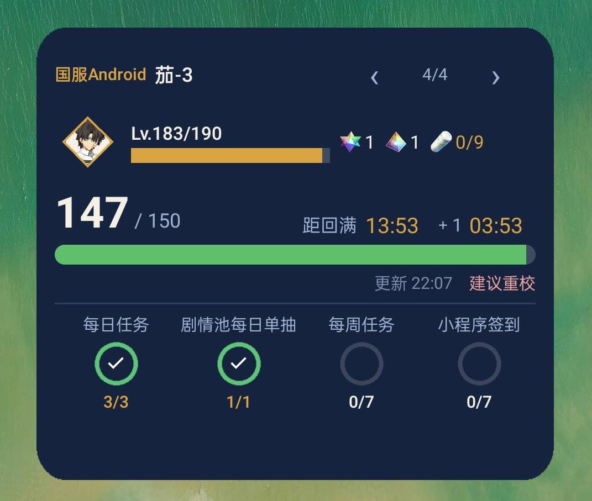
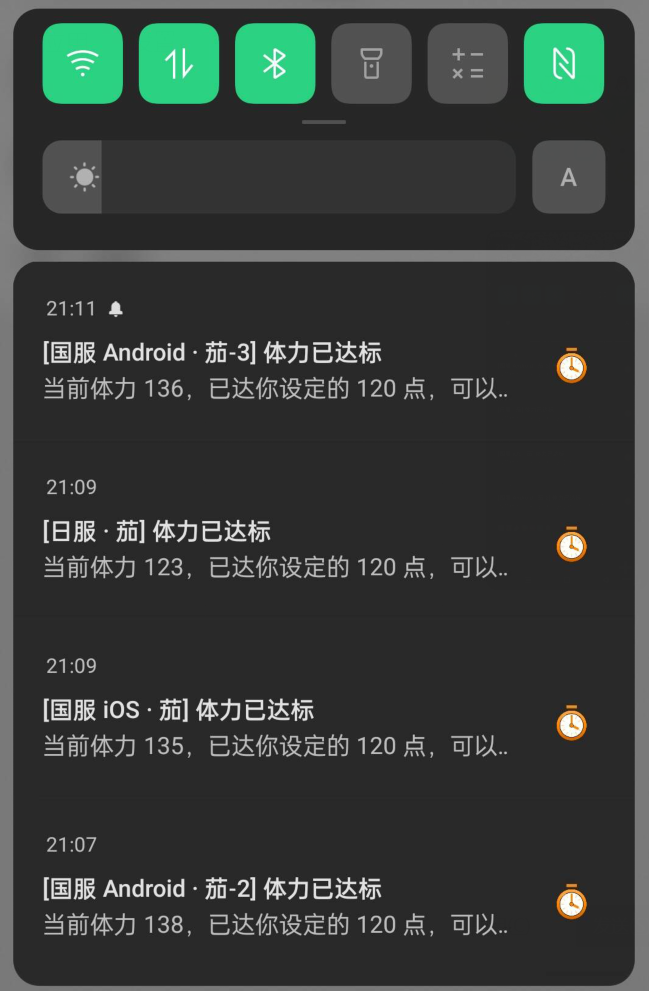

# FGO 体力监控

一个用来**盯体力**的 Android 小工具：不用一直开着游戏，体力快满了、待办没做完，它会在通知栏和桌面上提醒你。

> 单机应用，不联网、不读游戏数据、不需要账号密码。所有数字都由你自己填一次，之后靠本地时钟推算。



---

## 它解决什么问题

玩 FGO 的人大概都经历过：体力溢出好几个小时才发现，或者每天的四项日常忘了做，等想起来已经跨天。

这个 App 做的事很简单——**你把当前体力填进去，它算给你看**：

- 还有多久回满（精确到秒，桌面上真的在走）
- 距离下一次 +1 点还有多久
- 今天哪几项待办还没做
- 体力攒到某个值时震你一下 / 发封邮件

它**不碰游戏本体**，不注入、不读内存、不需要 root，也不需要任何账号。就是一个"你告诉它数字，它帮你算和提醒"的工具。

---

## 功能

### 桌面小组件（核心）

一个卡片同时放得下这些信息：

- 账号名 + 区服 + 御主头像 + 等级 / 等级上限
- 当前体力 / 上限，进度条
- 距回满（`10:17:19` 这种，每秒真的在走）、距下一点（`+1 02:19`）
- 圣晶石 / 圣晶片 / 风暴罐
- 待办进度环（做完的打勾）

多个账号可以点 `‹ 1/4 ›` 直接翻，不用进 App。

| 国服 iOS | 日服 |
|---|---|
|  |  |

| 国服 Android（满体力） | 国服 Android（小号） |
|---|---|
|  |  |

### 通知提醒

体力到达你设定的点数时，通知栏推一条，标题带区服和账号：

> **[国服 Android · 茄-3] 体力已达标**
> 当前体力 136，已达你设定的 120 点……



多账号同时达标时，每条通知是独立的，不会互相覆盖。

### 邮件提醒

除了通知，还可以配 SMTP 发邮件——适合"手机不在身边但想看邮箱"的场景。

**支持每个账号单独设置收件邮箱**：一台手机上跑着别人的号（比如帮人代挂），提醒可以发到他自己那里，而不是全塞进你的邮箱。

### 七项待办

| 待办 | 刷新 | 目标 |
|---|---|---|
| 每日任务 | 每日 00:00 | 3 |
| 剧情池每日单抽 | 每日 04:00 | 1 |
| 友情池免费十连 | 每日 00:00 | 1 |
| 每周任务 | 每周一 00:00 | 7 |
| 每月商店兑换 | 每月 1 号 | 1 |
| 圣杯铸造 | 每月 1 号 | 2 |
| 小程序签到 | 每月 1 号 | 7（仅国服官服） |

- **各项独立刷新**：0 点只归零"每日任务"，4 点才归零"剧情池单抽"，不会一锅端。
- **按区服自动过滤**：日服不会显示"小程序签到"（那是 B 站联动专属）。
- **每项可以单独关掉**：不想在桌面上看到的，滑一下开关就行（桌面最多放 4 个）。

### 多账号

最多 8 个号，每个号独立拥有：

- 区服（国服 Android / 国服 iOS / 国服渠道服 / 日服 / 国际服）
- 御主头像（13 种可选）
- 通知收件邮箱
- 待办进度与校准数据
- 小组件显示哪些待办

左侧栏切换，图标收起后可以腾出整屏给内容。

### 三种校准方式

数字怎么来？三种都行，按手头信息挑：

1. **手动输入** —— 直接填你看到的体力（最保底，永远可用）
2. **上限推算** —— 填"体力溢出多久了"，按 5 分钟 1 点倒推
3. **恢复点推算** —— 记得上次满体力是什么时候，从那算起

填完之后不用再管，之后靠本地时钟自己走。

---

## 下载

到 [Releases](https://github.com/nickname-unavailable/FgoApMonitor/releases) 下载最新 APK。

- 支持 Android 8.0 及以上
- 提供 `arm64-v8a`（绝大多数手机）和 `x86_64`（模拟器）两个版本
- 包体约 2.9 MB

### 安装时可能遇到的提示

因为没上应用商店，安装时系统会提示"未知来源应用"或"未经检测"，允许即可。

**关于签名**：1.0.0 起使用正式签名，证书 SHA-256 为

```
4A:D7:BC:05:B4:42:07:D5:E8:9E:FB:2E:7A:3D:8C:1F:03:A3:54:37:69:C5:99:90:98:B4:10:C7:0E:88:81:7C
```

如果安装包显示的是别的证书，别装。

> ⚠️ 从 0.27.x 及更早版本（debug 签名）升级到 1.0.0，**必须先卸载再装**，否则会提示"应用未安装"。卸载会清掉账号和校准数据。

---

## 快速上手

1. 打开 App → 左侧「添加账号」→ 选区服
2. 在「校准」页填一次当前体力（三种方式挑一种）→ 点右下角圆钮提交
3. 顺手把待办勾一下
4. 回到桌面 → 长按空白处 → 小组件 → 找到「FGO 体力监控」拖到桌面
5. 如果想让它在后台一直更新，去「后台」页把常驻服务打开

---

## 常见问题

**Q：桌面上的倒计时不动？**
A：第一次添加小组件后需要打开一次 App 推一次数据。之后倒计时由系统 `Chronometer` 自己走秒，不需要 App 醒着。

**Q：后台不更新？**
A：部分厂商（小米、华为、OPPO 等）会冻结后台应用。去「后台」页打开常驻前台服务，并在系统设置里允许自启动、关闭电池优化。

**Q：覆盖安装后提醒不响了？**
A：Android 在覆盖安装时会清掉应用注册的所有闹钟。装完新版本后**打开一次 App** 就会重新排上。

**Q：数据会上传吗？**
A：不会。所有数据只存在手机本地（DataStore），应用没有网络权限（除了你自己配的 SMTP 发邮件）。

**Q：能监控别人账号吗？**
A：可以，这就是「多账号」的用途之一——帮人代挂时把对方的号加进来，给那个号单独设一个收件邮箱，提醒就发到他那里。

---

## 技术栈

- Kotlin + Jetpack Compose（Material 3）
- Glance（桌面小组件，RemoteViews 混合渲染保证倒计时真的在走）
- DataStore（本地存储）
- AlarmManager + 前台服务（后台刷新）
- 自研 SMTP 客户端（无第三方依赖）

---

## 更新记录

见 [CHANGELOG.md](CHANGELOG.md)。

---

## 声明

- 本项目为**非官方**个人工具，与 TYPE-MOON / Aniplex / Bilibili 无关。
- 不读取、不修改游戏数据，不提供任何游戏内增益，仅做「时间推算 + 提醒」。
- 请遵守游戏用户协议，自行承担使用风险。
- 源码不公开。使用中遇到问题欢迎在 [Issues](https://github.com/nickname-unavailable/FgoApMonitor/issues) 反馈。
